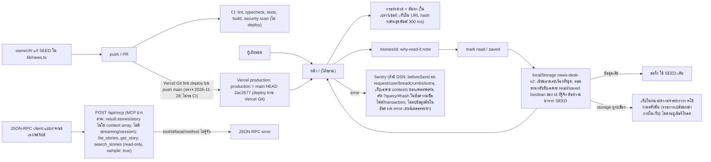

# 01 — Business process (As-Is / To-Be)

content-news-aggregator-web (News Desk, news-aggregator.bookchaowalit.com) คือเดโมโต๊ะอ่านข่าวที่ทำงานในเบราว์เซอร์ บนเรื่องตัวอย่าง 5 เรื่องที่เขียนไว้ในโค้ด (ไม่ใช่ข่าวจริงและไม่มี feed): ผู้เยี่ยมชมกรองตามหมวด ค้นหา เปิดเรื่อง และทำเครื่องหมายอ่านแล้ว/บันทึกไว้ใน `localStorage` ของตัวเอง

Last reviewed: 2026-11-28 · commit `844f081`

## As-Is (จากโค้ดวันนี้)

Sources: `lib/news.ts`, `lib/desk-hash.ts`, `app/page.tsx`, `app/stories/[id]/page.tsx`, `app/api/mcp/route.ts`, `lib/sentry.ts`, `.github/workflows/ci.yml`, `README.md`, `PRODUCT.md`

หมายเหตุ: `PRODUCT.md` (2026-10-23) ระบุว่า Vercel Git link ชี้รีโปเก่า จึงไม่ deploy จาก push main แต่ตรวจ Vercel API 2026-11-28 แล้ว Git link ชี้ repo นี้ production branch `main` และ production = main HEAD 2ac2577 (deploy ผ่าน Vercel Git). เครื่องหมาย read/saved ไม่ถูกส่งไป server และ MCP ไม่เห็นค่านี้

## To-Be

ไม่มี To-Be ที่เขียนไว้ (`PRODUCT.md` ระบุว่าไม่มี RSS/AI scoring/dedup และไม่ได้กำหนดเป็นเป้าหมาย)

## Gap

| ID | As-Is → To-Be | Status | Owner | Evidence |
|---|---|---|---|---|
| G1 | ไม่มี To-Be ของกระบวนการ → owner กำหนดว่าจะต่อ feed จริง (RSS ฯลฯ) หรือคงเป็นเดโมตัวอย่าง | decide | owner | ไม่มีใน `PRODUCT.md` / `specs/` |
| G2 | push main ไม่ deploy ตามสถานะที่บันทึก 2026-10-23 (Vercel Git link ชี้รีโปเก่า) → ตรวจ Git link และ commit ที่ production รัน แล้วผูก Vercel Git | done | owner | `PRODUCT.md` §Live URL and deploy state (D9); Vercel API 2026-11-28: project `bookchaowalit-news-aggregator-frontend` Git link → `bookchaowalit-website/content-news-aggregator-web`, production branch `main` |

## Open questions

- ข้อจำกัดด้านการเลื่อนหน้า/การคืนค่า filter ตอนกด Back อยู่ใน `PRODUCT.md` §Known limits ยังไม่มีแผนแก้ที่เขียนไว้
